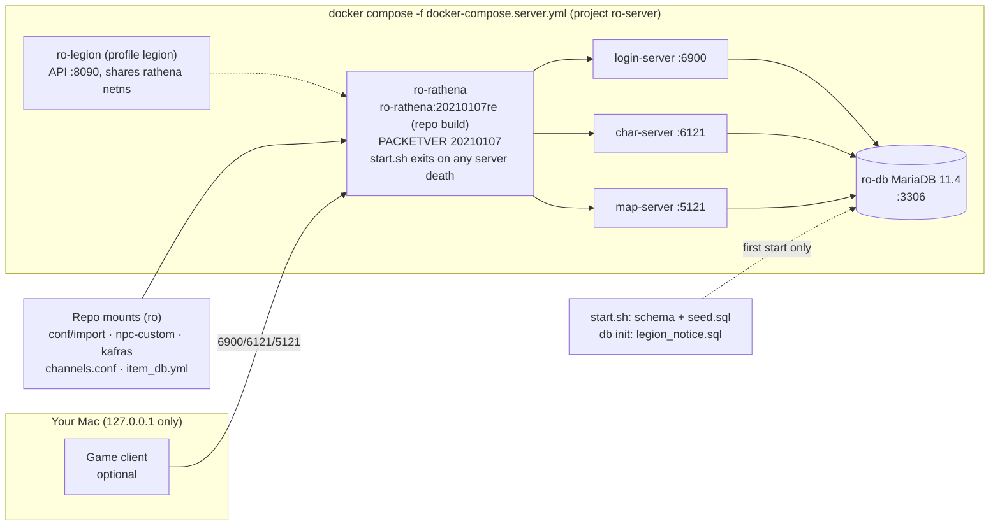
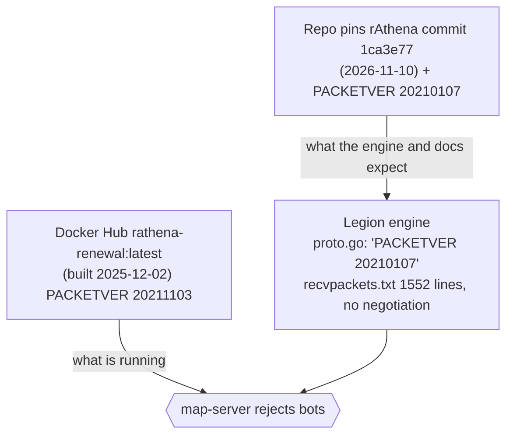
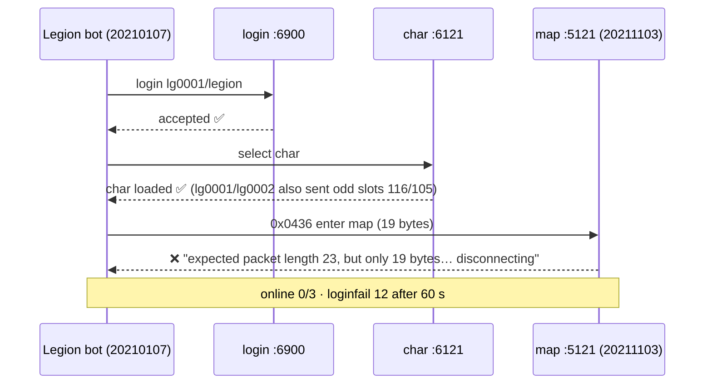
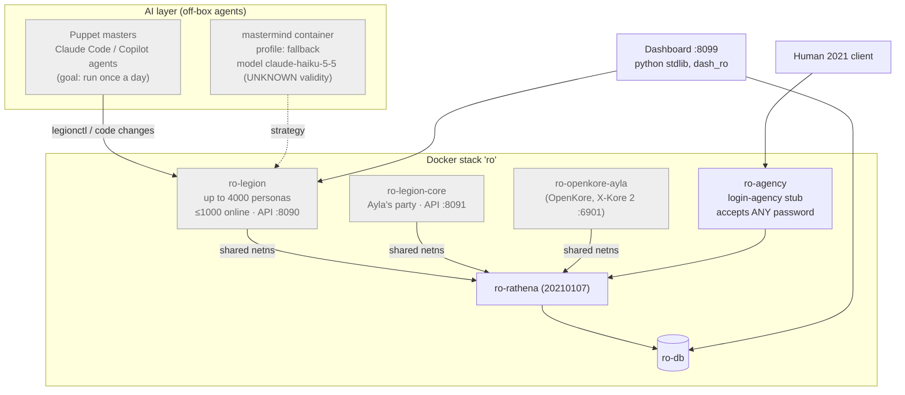

# Legion — full review & honest assessment (2026-11-15)

Repo: `kod88vn/legion` (private), cloned to `~/dev/legion`. Running locally: `ro-db` + `ro-rathena` from `docker-compose.server.yml`. The rathena image is the repo's own build, `ro-rathena:20210107re`, made locally; the Docker Hub image is no longer used.

> **Update 2026-11-16: gap #1 is closed.** No Docker Hub image can run Legion. Every rAthena image I could check is built outside the 20210107 window (rAthena's packet thresholds put that window between 20201118 and 20210203); the official images all use 20211103. So I built the repo's image locally, with the Zscaler CA added to the base image and `make -j2` so the compile doesn't run out of memory. `config.log` shows `PACKETVER=20210107` (VERIFIED). I re-ran the same 3-bot test. **Before (Hub image): online 0/3, 12 login failures. After: online 3/3, 9 kills, 0 login failures, no packet errors on the map server** (VERIFIED, `/api/stats`). The repo's `start.sh` already exits when any server dies: I killed the login server, the container restarted (restarts=1), and login answered `0x0ac4` (VERIFIED). That made `hub-start.sh` unnecessary, so I removed it.

Tags: **VERIFIED** = command run in this session, falsifiable output observed · **ASSUMED** = not run · **UNKNOWN** = could not determine.

---

## 1. TL;DR verdict

| Area | Grade | One line |
|---|---|---|
| rAthena server you asked for | **B+** | Runs, logins work, configs are small and well-commented. It's for a local lab only (plaintext passwords, default creds). |
| rAthena image for Legion | **Fixed (was D)** | The Docker Hub image (packet 20211103) can't host the engine (§4). The repo's own build, `ro-rathena:20210107re`, can: 3/3 bots online (VERIFIED, 2026-11-16). |
| Legion Go engine | **B- (unproven)** | 96k LOC, 141 test files, no deps. Ambitious and serious, but hard-wired to one packet version. No live, load or race evidence. |
| Project as a whole vs. its goal | **C** | Lots of code is merged, but **nothing is deployed or live-verified**. The end goal ("world runs without AI") is undemonstrated. |
| Process / governance | **C-** | 200+ rule IDs and ~6.4k lines of governance docs, yet 44 merges are unreviewed and 4 merged against "do not merge". |
| Portability / CI | **D** | Windows+WSL baked in (194 hits across 47 files). No CI workflow. |

**Bottom line:** this is a big, thoughtful hobby/research project with a real engine. Its main risk isn't missing code. **It has not been run end-to-end against its goal yet.** The server it needs now runs on a Mac (`docker-compose.server.yml`), so that run is no longer blocked by the image.

---

## 2. What is running now (VERIFIED 2026-11-16)

Evidence:
- `docker inspect ro-rathena`: image `ro-rathena:20210107re`. `/rathena/config.log`: `-DPACKETVER=20210107`.
- Map server: `Map-Server 0 connected: 1265 maps`, `Map Server is now online`.
- Login from a protocol client: `player/player -> 0x0ac4` (accepted), `player/WRONG -> 0x083e` (refused).

### How the image is built on a Mac
The steps are in the header of `docker-compose.server.yml`:
1. A helper base image `ubuntu-zscaler:24.04` (`ubuntu:24.04` + the corporate Zscaler CA). Without it, the build's
   `git fetch` of rAthena fails TLS behind the proxy.
2. `rathena/Dockerfile` with `make -j2` instead of `-j"$(nproc)"` (the full-core compile ran out of memory), built
   with `--build-context ubuntu:24.04=docker-image://ubuntu-zscaler:24.04 --build-arg PACKETVER=20210107`.
3. `docker compose -f docker-compose.server.yml up -d`; the engine is `--profile legion up -d legion`.

The repo's `rathena/Dockerfile` itself is unchanged; the Zscaler CA and `-j2` are applied at build time only.

### Issues I found in my own deployment, now fixed
| # | Problem | Proof | Fix |
|---|---|---|---|
| 1 | `legion_notice` table missing, so the MarketCrier NPC failed its SQL query every minute | log: `Table 'ragnarok.legion_notice' doesn't exist` | `docker-compose.server.yml` mounts `rathena/sql/legion_notice.sql` into the db init folder. After the fix: **0** errors in 70 s. |
| 2 | Silent outage on the Hub image: login/char ran as unsupervised background jobs | killed `login-server` → container still `Up 8 minutes`, logins failed | Not needed on the repo build: `rathena/start.sh` already exits when any server dies. Re-test: killed login, `restarts=1`, login `0x0ac4` again. The Hub-only `hub-start.sh` was removed. |
| 3 | Hub image is packet 20211103, so no bot could enter a map (§4) | `online 0/3`, 12 login failures | Build the repo image at PACKETVER 20210107. Re-test: `online 3/3`, 9 kills, 0 login failures, no map-server packet errors (`/api/stats`). |

---

## 3. Server config review (rathena/ overrides, ~1.6k lines)

**Good**
- Small, targeted overrides, with a comment explaining every change (`battle_conf.txt`, `packet_conf.txt`, `log_conf.txt`).
- The no-rebirth server cap is done cleanly: `delnpc` in `npc-custom/scripts_custom.conf` (with the correct reason why it can't live in map_conf), plus a trimmed `valkyrie_norebirth.txt`.
- Overrides of upstream files are minimal. The Kafra file differs from the image's copy only in prices (26 diff lines). `channels.conf` only flips `autojoin`.
- The crier script claims its row before announcing, so it never repeats a notice (`legion_crier.txt:28-31`).

**Concerns**
| Severity | Finding | Where |
|---|---|---|
| High (if ever exposed) | Plaintext passwords (`player/player` is GM 99), default inter-server account `s1/p1`, DB `ragnarok/ragnarok`, `new_account: yes`, `check_client_version: no` | `sql/seed.sql:4-6`, `conf/import/login_conf.txt`, compose |
| Medium | `packet_conf.txt` allows 127.0.0.1 to bypass the DDoS guard. That's needed for bots, but anything in the namespace is trusted. | `conf/import/packet_conf.txt:4-7` |
| Low | Comment says "double the monster population", but `mob_count_rate: 400` = **4x** | `battle_conf.txt:10-11` |
| Low | `log_chat: 63` logs whispers as well. That's fine for a lab, but it's a privacy decision. | `log_conf.txt:3` |
| Low | Crier window 08–22 is **UTC** (container has no TZ), which is 03:00–17:59 EST | `legion_crier.txt:5-6` |
| Info | `legion.txt` `S_Change` ends the script after the first job change, so only one promotion happens per event. Harmless. | `npc-custom/legion.txt:96-99` |

---

## 4. Version mismatch (biggest finding, VERIFIED; resolved 2026-11-16)

Smoke test: I built the engine against the Hub image's game data, seeded 3 personas into the bot account range, then cleaned up afterwards.

**Implication:** for the project's purpose, the Docker Hub image is a dead end. No Hub rAthena image is built inside
the 20210107 packet window (rAthena's thresholds: 20201118 < v < 20210203); the official images are 20211103.

**Resolved 2026-11-16:** built `rathena/Dockerfile` at PACKETVER 20210107 (pinned commit) with the Zscaler CA and
`make -j2` (§2). Same 3-bot test: **before** online 0/3, 12 login failures; **after** online 3/3, 9 kills, 0 login
failures, no packet errors on the map server (VERIFIED, `/api/stats`).

---

## 5. Intended full architecture (from `docker-compose.yml` and docs)

Grey = currently **stopped by design** (STATUS.md:15-18; owner gate G21).

---

## 6. Legion engine (static review + live smoke)

| Metric | Value |
|---|---|
| Go files / LOC | 323 / 96,024 (VERIFIED `wc`) |
| Test files / test LOC | 141 / ~21.9k |
| External deps | none (stdlib only; `go.mod` go 1.22) |
| Largest files | `ai.go` 3,346 · `lfg.go` 2,223 · `economy.go` 2,128 · `party.go` 1,834 · `bot.go` 1,685 |
| Model | goroutine per bot plus manager goroutines; state in JSON/JSONL under `/data` |
| Startup (VERIFIED) | 1296 maps, 2555 monsters, 4270 warps loaded in ~250 ms; heap ~276 MB with 3 bots |

**Strengths:** no dependency rot, real behavioural tests (not just trivial asserts), fast data load, explicit login staggering and online caps.

**Gaps (ranked)**
1. **Protocol is hard-wired to 20210107** with no version table selection. Proven fatal on 20211103.
2. **No race or load evidence.** It's a shared-state design with many mutexes and 1000 online sessions, near the map-server limit of about 1013.
3. **Silent loader fallbacks.** Example seen live: `kafra: … is the stock file, not the Legion copy … built-in destination table`. Missing or mismatched data degrades quietly instead of failing.
4. `Conn.Send` does a single `Write` with no short-write handling (`proto.go:44-58`).
5. A hand-written YAML subset parser for rAthena item_db is fragile across rAthena revisions.
6. Several 1.5k–3.3k-line files mix responsibilities, and API routes are scattered across files.
7. Persistence is spread over many JSON writers, and atomic writes and recovery aren't uniform.

---

## 7. Tooling, tests, ops

- `tools/` holds ~19k lines of Python/shell (dashboard 3k, puppet 3.6k, system 7.9k). `tests/` is run by `tools/system/runsuites.py`. PROGRESS claims 803 Python tests, run once on the branch base.
- **No CI.** `.github/` has agents and instructions but no workflows.
- **Portability:** `G:/RO`, `/mnt/g`, `.cmd`, WSL and MSYS assumptions appear in 47 files. Ops scripts (`keeper.sh`, `gocheck.sh`, `qa7_hb.sh`, `mem.py`, `buildexport.py`) won't run on macOS/Linux as they are.
- **Stale doc (VERIFIED):** `docs/SETUP-NEW-MACHINE.md:58` says "There is no git remote in this clone", but we cloned it from GitHub.
- **History:** all 677 commits are dated 2026-11-14 (150) and 2026-11-15 (527). ASSUMED: this is a re-import/sync ("Sync with live main"), so `git log` doesn't show the real development timeline or review trail.
- Mastermind default model `claude-haiku-5-5`: UNKNOWN whether this is a valid model ID. There's no spend cap, and errors fall back silently.

---

## 8. End goal and the gap to it

**Goal** (CONSTITUTION.md:47-57, 88-90; REDESIGN.md:7-22): *"a world that runs without AI: only the puppet masters run, once a day."* Bots pursue their own builds, farming, trading, partying and guild life in code. AI improves the code; it doesn't drive the characters. Success is measured in kills/min and zeny/hour, with Ayla as the test subject whose proven fixes spread to Legion.

```mermaid
flowchart LR
  subgraph Done["✅ Done (code merged)"]
    T[T Toolchain]
    Mt[M Meter]
    G[G Guild duty]
    X[X Exchange/chat]
    P[P Puppet harness]
    S[S System agents]
    R[R Rules trim]
  end
  subgraph Blocked["⛔ Blocking first deploy"]
    B1[Deploy gate M1/M2]
    B2[Sentinel algo: 2 majors]
    B3[18 stray aylawatch.sh]
    B4[44 unreviewed merges<br/>4 merged vs 'do not merge']
  end
  subgraph NotStarted["⬜ Not started"]
    D1[First deploy<br/>owner G21]
    D2[Live meter proof<br/>kills/min · zeny/h before/after]
    D3[Ayla cut-over AY24]
    D4[Market rollout<br/>flags off, no farmer roster]
    D5[Daily puppet-master loop<br/>with measured improvement]
  end
  GOAL(("🎯 World runs<br/>without AI"))
  Done --> Blocked --> D1 --> D2 --> D3 --> D4 --> D5 --> GOAL
```

### Gap list, in the order I'd tackle it

| # | Gap | Why it matters | Concrete next step |
|---|---|---|---|
| 1 | ~~**Server can't host the bots on this Mac**~~ **Done 2026-11-16** | Nothing downstream could be validated | Built `ro-rathena:20210107re` locally with the Zscaler CA and `make -j2`; `docker-compose.server.yml` runs it. 3/3 bots online. |
| 2 | **Zero live evidence** of the core thesis | "Merged" ≠ works; the goal is about live behaviour | Run a 50 → 200 → 1000 online ramp. Record meter kills/min, zeny/h, deaths and loginfail. Define pass thresholds first. |
| 3 | **Deploy blockers** (M1/M2, sentinel majors, stray watchers) | PLAN.md says they block the first deploy | Fix and close them with tests that were observed failing first |
| 4 | **Review debt** (44 unreviewed, 4 overridden) | Unknown defects are sitting on `main` | Triage the 4 overridden merges first, then batch-review by subsystem |
| 5 | **Concurrency & load** | 1000 goroutine bots on shared state | `go test -race` in CI, plus a soak test (≥2 h, 1000 online) checking for heap and goroutine growth |
| 6 | **Protocol fragility** | Any rAthena or client change breaks the engine | Fail fast on packet-length mismatch at login, and pin the server image digest beside `recvpackets.txt` |
| 7 | **Silent data fallbacks** | Bots behave subtly wrong instead of failing | Make loaders strict, with required-file and record-count assertions at startup |
| 8 | **Ayla cut-over and market** | Both are part of the goal and both are switched off | Follow the documented AY24 order. Turn on one market flag at a time with meter comparisons. |
| 9 | **Autonomy loop** (puppet masters once a day) | This *is* the end state | Schedule one daily run that reads the meter, proposes one code change, A/B deploys it and keeps or reverts. Track AI minutes per day trending to the target. |
| 10 | **CI & portability** | Every check today depends on one Windows machine and one owner | GitHub Actions for `go vet/test -race` and `runsuites.py`. Replace `G:/RO` paths with a repo-root or env var. |
| 11 | **Governance weight** | 200+ rule IDs and 6.4k doc lines, yet review gaps still slipped through | Keep the ~25 hard gates and enforce them in CI rather than in prose. Archive the rest. |
| 12 | **Security** (only matters if exposed) | Agency accepts any password, plus default creds | Keep everything on 127.0.0.1. Rotate creds and hash passwords before any LAN or remote use. |

---

## 9. Files added to the repo
- `docker-compose.server.yml` (repo root): db + rathena (`ro-rathena:20210107re`), plus a `legion` service under the `legion` profile. The repo's `start.sh` loads the schema and seed on first run; `legion_notice.sql` is loaded through the db init folder. The comments at the top of the file hold the build commands.
- `docs/reports/legion-review-20261115.md`: this review.
- Removed before commit (Hub-only, never committed): `docker-compose.hub.yml`, `rathena/hub-start.sh`, `rathena/hub-initdb/`.
- Local images (not in the repo): `ubuntu-zscaler:24.04` (build helper), `ro-rathena:20210107re`, `ro-legion:latest`.

The smoke-test bot accounts were removed afterwards (VERIFIED: `count = 0` for account_id ≥ 2100001).
